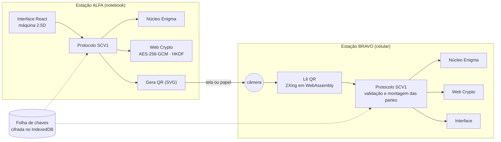

# SCV Enigma: Enigma × Criptografia Moderna

**Hackathon Univassouras Maricá 2026 · Desafio 2: Comunicação Segura · equipe SCV Technologies**

Uma rede de 2 a 4 máquinas Enigma virtuais, fiéis à original e totalmente visuais, que trocam mensagens
por QR Code e as comparam, lado a lado, com a criptografia de hoje (AES-256-GCM). Roda no computador e
no celular, instala como app e funciona sem internet. Nada sai do aparelho.

> A Enigma não caiu só pela matemática: caiu por um detalhe de projeto (nenhuma letra vira ela mesma)
> somado a procedimentos previsíveis e chaves capturadas. O app mostra as duas coisas acontecendo e o
> que a criptografia moderna faz diferente.

## O problema e a solução

O desafio pede uma Enigma imersiva, com a cifra fiel, transporte por QR com cabeçalho de protocolo,
gestão de chaves para várias máquinas e um comparativo com um algoritmo atual. A solução:

| Demanda do edital | Onde está |
|---|---|
| Plataforma: computador e celular | Web responsiva de 360 px a desktop; PWA instalável e offline |
| Máquina imersiva: teclado clicável com som, lâmpadas, rotores girando, tampa que abre e troca rotores, plugboard com cabos arrastáveis | Tela **Máquina** (`src/ui/machine/`) |
| Cifra fiel: avanço a cada tecla, refletor, plugboard, ordem/posição/anéis como chave | `src/core/enigma/`, testada com a mensagem real da Operação Barbarossa (1941) |
| Transporte por QR com cabeçalho (remetente, destinatário, indicador de chave) e leitura pela câmera | Telas **Transmitir** e **Receber**; protocolo em [docs/PROTOCOLO.md](docs/PROTOCOLO.md) |
| Envio opcional por mídia física | Arquivo `.txt` para pendrive/cartão SD e leitura de arquivo |
| Folha de chaves compartilhada; remetente e destinatário com 3 ou 4 máquinas | Tela **Folha de chaves**: o Comando gera e distribui por QR a cópia de cada estação |
| Versão moderna obrigatória: a mesma mensagem em algoritmo atual | AES-256-GCM via Web Crypto, chave por par de estações (HKDF-SHA-256) |
| Comparativo: espaço de chaves e força bruta; a falha da Enigma e análise de frequência; adulteração detectada só no moderno | Tela **Enigma × AES** e o **laboratório de adulteração** da tela Receber |
| Prova ao vivo de que chave errada dá texto ilegível | Botão “decifrar com UM anel errado” na recepção |

Diferenciais do edital, todos implementados:

- **Caminho elétrico animado** da letra pelo plugboard, rotores e refletor, com a fiação interna de cada rotor.
- **Modo Bletchley Park**: arrasta o crib usando a falha da Enigma e roda uma **Bomba de Turing-Welchman**
  de verdade, em paralelo em todos os núcleos, que recupera ordem dos rotores, anéis, chave da
  mensagem e plugboard (medido: as 60 ordens em ~7 s num notebook de 12 threads).
- **Mensagens longas em vários QR numerados**, mostrados em sequência automática (QR animado) ou impressos.
- **QR adulterado ou incompleto detectado** no modo moderno, apontando qual parte falhou.
- **PWA instalável e offline**, som mecânico sintetizado, ambiente de sala de rádio e narrativa histórica.

## Como demonstrar (2 aparelhos)

1. **Notebook (Comando, estação ALFA):** Folha de chaves → Gerar a folha → Distribuir para BRAVO, com senha.
2. **Celular (BRAVO):** Folha de chaves → câmera no QR → digita a senha → confere o código → aceita.
3. **ALFA:** Transmitir → a máquina digita o procedimento de 1940 → QR Enigma e QR AES.
4. **BRAVO:** Receber → lê os QR → texto decifrado. Botão do anel errado: ilegível. Laboratório de
   adulteração: a Enigma entrega o texto adulterado; o AES recusa.
5. **Bletchley Park:** mandar a mensagem interceptada → crib → Bomba → chave recuperada em segundos.
6. **Enigma × AES:** espaço de chaves, força bruta, diagonal vazia, frequências.

Sem câmera? A recepção lê foto do QR, texto colado ou arquivo `.txt`.

## Arquitetura

Tudo roda no navegador; não há servidor. O canal é o próprio QR (rede isolada, como na Defesa Civil em
desastre), o que também resolve a LGPD por desenho: não existe banco de dados central para vazar.



As camadas são separadas, como pede o edital (cifra, protocolo e interface):

| Pasta | Responsabilidade | Depende de |
|---|---|---|
| `src/core/enigma` | Máquina fiel (I, M3, M4), passo duplo, rastro da corrente, espaço de chaves | nada |
| `src/core/modern` | AES-256-GCM, HKDF, PBKDF2, Base45, aleatoriedade sem viés | Web Crypto |
| `src/core/protocol` | Quadros SCV1, folha de chaves, indicador de 1940, partes, montagem | enigma, modern |
| `src/core/analysis` | Frequência, índice de coincidência, crib, Bomba, verificação, força bruta | enigma |
| `src/ui` | Telas React, máquina 2.5D, QR, som, armazenamento cifrado | core |
| `src/workers` | Uma Bomba por núcleo da CPU | analysis |

O núcleo não conhece a interface: dá para trocar a interface 2.5D por uma 3D sem mexer na cifra.

### O caminho de uma letra

A tecla fecha o circuito e, **antes** da corrente passar, o rotor da direita anda (se ele estava no
entalhe, arrasta o do meio; se o do meio estava no próprio entalhe, ele anda de novo junto com o da
esquerda: o *passo duplo*). A corrente passa pelo plugboard, atravessa os três rotores da direita para
a esquerda, o refletor a devolve por **outro** contato, ela volta pelos rotores e pelo plugboard e
acende a lâmpada. Como o refletor nunca liga um contato a ele mesmo, **nenhuma letra é cifrada como ela
mesma**: a falha que Bletchley Park explorou. Como o caminho é o mesmo nos dois sentidos, a mesma chave
cifra e decifra.

### Por que o AES resiste onde a Enigma falhou

| | Enigma | AES-256-GCM |
|---|---|---|
| Espaço de chaves | 1,59 × 10²⁰ (~67 bits; ~77 com anéis) | 2²⁵⁶ ≈ 1,16 × 10⁷⁷ |
| Estrutura explorável | Refletor: letra nunca vira ela mesma | Nenhuma conhecida; projeto público e analisado há 25 anos |
| Texto conhecido (crib) | Entrega a chave (Bomba) | Não ajuda |
| Integridade | Nenhuma | Etiqueta de 128 bits sobre texto e cabeçalho |
| Mesma mensagem duas vezes | Mesmo texto cifrado | Textos diferentes (nonce e sal novos) |
| Chave | Uma por rede: todos leem tudo | Uma por par de estações |

## Segurança e LGPD

- Criptografia só pela **Web Crypto API** do navegador (nada de AES feito à mão); aleatoriedade de
  `crypto.getRandomValues`, com amostragem por rejeição para não haver viés de módulo.
- Todo QR, arquivo e folha recebidos são **dado hostil**: parsers estritos, limites de tamanho, teto de
  descompressão (contra bomba de compressão), nada é interpretado como HTML; o QR é desenhado pelo
  próprio app como SVG.
- **Menor privilégio**: cada estação recebe só os segredos dos seus pares. Distribuição da folha com
  senha (PBKDF2-HMAC-SHA-256, 600 mil iterações, recomendação da OWASP) e código de conferência de 80 bits.
- **Cifra em repouso**: a folha fica no IndexedDB cifrada com AES-256-GCM, com uma chave que o navegador
  gera como **não exportável**.
- **CSP** restritiva no build; nenhum script ou fonte de terceiros em tempo de execução.
- **LGPD**: nenhum dado pessoal é coletado, não há conta, servidor nem rastreamento; tudo fica no aparelho
  (minimização e privacidade desde a concepção, arts. 6º e 46).
- Limites assumidos: o Comando conhece todos os segredos (modelo de centro de distribuição de chaves);
  não há sigilo futuro; a Enigma é insegura de propósito (é o objeto de estudo).

Durante o desenvolvimento, a revisão automática de segurança apontou três riscos na distribuição da
folha (bomba de compressão, folha forjada sem senha, código de conferência curto); os três foram
corrigidos e cobertos por testes (ver histórico de commits).

## Testes

```bash
npm test          # 71 testes unitários (Vitest)
npm run test:e2e  # 5 testes de ponta a ponta no navegador (Playwright), contra o build de produção
npm run check     # lint + tipos + unitários + build + ponta a ponta
```

O que eles provam:

- **Fidelidade:** `AAAAA → BDZGO` (I II III, AAA), `EWTYX` (anéis BBB), sequência do passo duplo
  `ADU → ADV → AEW → BFX → BFY`, e as **duas partes da mensagem real da Operação Barbarossa (1941)**
  decifradas letra por letra; M4 com Beta em A e refletor B-fino igual à M3 com refletor B.
- **Propriedades:** reciprocidade em 50 chaves aleatórias; nenhuma letra cifrada nela mesma em 80 mil
  teclas; chave errada (um anel) não decifra.
- **Moderno:** vetores da RFC 9285 (Base45); qualquer bit alterado, parte trocada, cortada ou fora de
  ordem, cabeçalho alterado ou chave de outro par: recusa.
- **Bomba:** 12/12 chaves aleatórias recuperadas com a ordem conhecida; busca completa nas 60 ordens.
- **Ponta a ponta:** dois navegadores (dois aparelhos): folha por foto do QR com senha e código de
  conferência; mensagem Enigma e AES por foto do QR; chave errada; adulteração; uso offline; e a
  **câmera ao vivo**, com um vídeo de câmera falsa mostrando um QR (getUserMedia → canvas → ZXing); e a
  Bomba rodando no worker do build de produção até recuperar a mensagem.

## Como executar

Requisitos: Node 22 ou mais novo.

```bash
npm ci
npm run dev       # http://localhost:5173
npm run build     # gera dist/
npm run preview   # serve o build
```

A câmera só funciona em **HTTPS** ou em `localhost` (regra dos navegadores). Para testar no celular,
use a versão publicada no GitHub Pages (o workflow `.github/workflows/pages.yml` publica a cada push na
`main`) ou leia o QR por foto.

## Tecnologias e créditos

| Item | Uso | Licença |
|---|---|---|
| React 19, TypeScript 6, Vite 8 | Interface e build | MIT / Apache-2.0 |
| Vitest 5, Playwright 1.64, ESLint 10 | Testes e qualidade | MIT / Apache-2.0 |
| [zxing-wasm](https://github.com/Sec-ant/zxing-wasm) 3.1.6 | Leitura de QR (ZXing-C++ em WebAssembly) | MIT (ZXing: Apache-2.0) |
| [qrcode](https://github.com/soldair/node-qrcode) 1.5.4 | Geração da matriz do QR | MIT |
| vite-plugin-pwa 2.0 (Workbox) | Service worker e manifesto | MIT |
| IBM Plex Sans e Mono; Special Elite | Fontes, embutidas para uso offline | OFL-1.1; Apache-2.0 |
| *Dom Casmurro*, Machado de Assis (Projeto Gutenberg nº 55752) | Estatística do português para a Bomba | Domínio público |

Fiação dos rotores conforme o Crypto Museum e a literatura citada; nenhuma imagem, marca ou logotipo de
terceiros foi usado (a máquina e os ícones são desenhados em CSS/SVG pela equipe; os sons são
sintetizados).

**Código preexistente da equipe:** nenhum. Todo o código foi escrito durante o evento.

## Ferramentas de IA utilizadas

Conforme o item 7.3 do edital: usamos o **Claude Code** (Anthropic) como ferramenta principal de
desenvolvimento. Ele escreveu a maior parte do código, dos testes e da documentação a partir das nossas
instruções, e pesquisou e conferiu as referências. A equipe escolheu o escopo e as prioridades (trilha
2.5D, transporte por QR, modo Bletchley Park), revisou e testou o resultado nos aparelhos e estudou cada
parte da solução para explicá-la na arguição.

## Divisão de tarefas

| Integrante | Responsabilidade |
|---|---|
| Ana Clara Moledo Neves (líder) | Coordenação, roteiro e condução do pitch, documentação do protocolo, testes com usuários |
| Daniel Alvarez Gonçalves | Núcleo criptográfico (Enigma e AES), protocolo SCV1, modo Bletchley Park |
| Victor Bernardo Tatagiba | Interface e experiência, testes no celular (câmera, PWA), folha de chaves |

## Referências

Lista completa, com DOI, na tela **História** do app. Principais: M. Rejewski (1980), *Applicationes
Mathematicae* 16(4):543–559; A. M. Turing, *Treatise on the Enigma* (c. 1940); G. Welchman, *The Hut Six
Story* (1982); D. H. Hamer (1997), *Cryptologia* 21(1); A. R. Miller, *The Cryptographic Mathematics of
Enigma* (NSA, 1995); J. Gillogly (1995), *Cryptologia* 19(4); O. Ostwald e F. Weierud (2017),
*Cryptologia* 41(5):395–421; C. Shannon (1949); NIST FIPS 197 (AES) e SP 800-38D (GCM); RFC 5869
(HKDF); RFC 9285 (Base45); Hoang, Reyhanitabar, Rogaway e Vizár, CRYPTO 2015 (STREAM).
